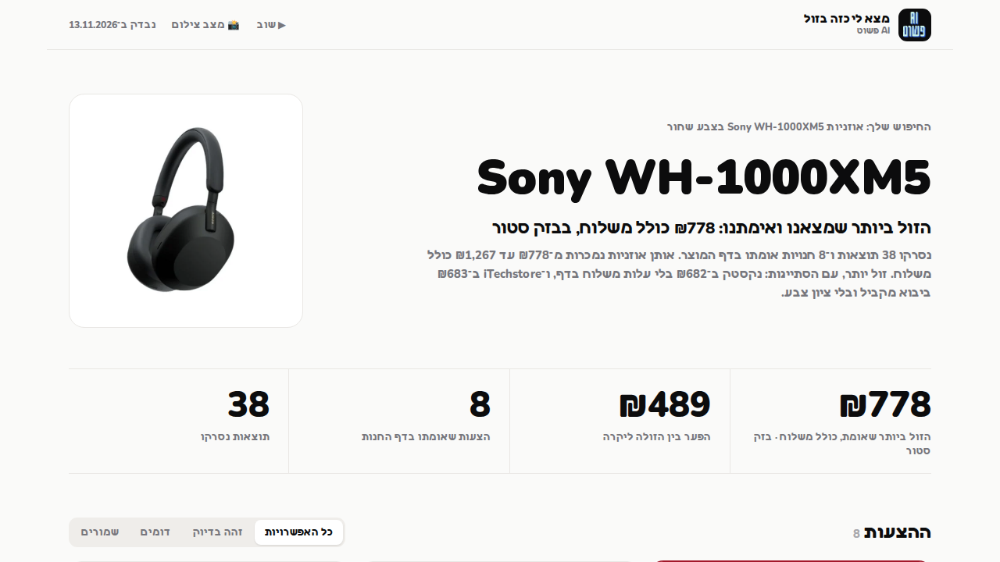
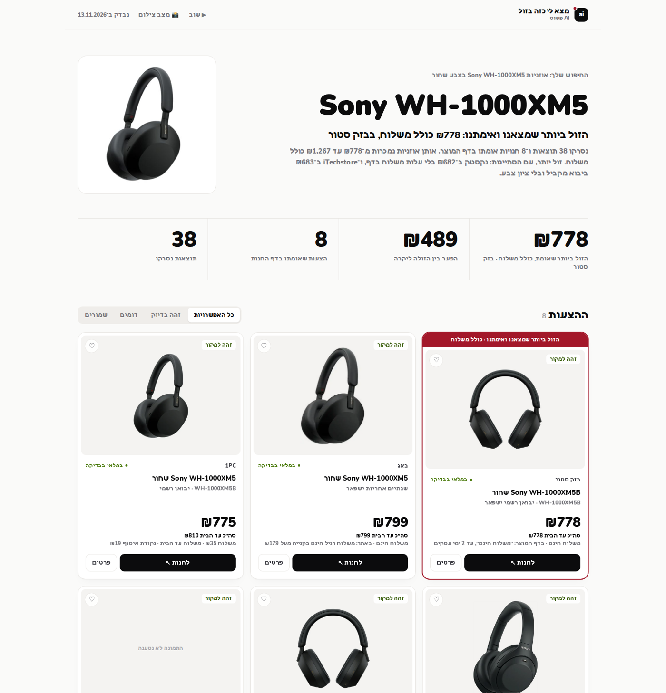

<div dir="rtl">

# מצא לי כזה בזול

סקיל ל-Claude Code ול-Codex שמחפש כל מוצר בחנויות ברשת, פותח את דפי המוצר עצמם, ומחזיר דף מונפש עם ההצעות שאומתו.

שולחים תמונה, קישור או שם של מוצר. מקבלים דף שנפתח לבד בדפדפן.





מבית AI פשוט, בני פרבר.

## מה הוא עושה

1. מזהה את המוצר מתוך תמונה, קישור, דגם או תיאור.
2. מחפש בכמה חנויות, כולל דרך אתרי השוואת מחירים, ופותח כל דף מוצר.
3. קורא מהדף עצמו מחיר, משלוח, מלאי ואחריות. תוצאת חיפוש היא רק רמז, לא הוכחה.
4. בונה דף אחד: אנימציה קצרה של החיפוש, ואחריה דוח עם כרטיס לכל הצעה וקישור לחנות.

## מה הוא לא עושה

- לא מבטיח את המחיר הזול ביותר ברשת. הוא מראה את הזול ביותר שהצליח לאמת, ואומר מה לא הצליח לבדוק.
- לא מציג משלוח חינם כשעלות המשלוח לא ידועה, ולא משווה מחירים במטבעות שונים.
- לא קונה, לא נרשם לאתרים ולא מוסיף קישורי שותפים.
- המחירים נכונים לרגע הבדיקה. בודקים שוב בחנות לפני שקונים.

## מה צריך

- Claude Code (כלול במנוי Claude בתשלום) או Codex של OpenAI.
- פייתון 3.9 ומעלה. במק הוא בדרך כלל כבר מותקן. בווינדוס מתקינים מ-python.org.
- אין מפתח API ואין תשלום נוסף.

## התקנה ב-Claude Code

מדביקים את זה ב-Claude Code ולוחצים Enter:

```
התקן לי את הסקיל "מצא לי כזה בזול": הורד את https://github.com/BunuF86/find-it-cheaper לתיקייה ~/.claude/skills/find-it-cheaper (עם git clone, ואם אין git הורד את קובץ ה-zip של הריפו וחלץ אותו לשם). אם סביבת העבודה חוסמת כתיבה לתיקייה הזו, בקש ממני אישור להריץ את הפקודה מחוץ לסביבת העבודה, ואל תדלג על ההתקנה המקומית. בדוק שפייתון 3 מותקן, ואם לא, הסבר לי איך להתקין. בסיום הפעל את הסקיל מהתיקייה שהתקנת ושאל אותי איזה מוצר לחפש.
```

## התקנה ב-Codex

```
התקן לי את הסקיל "מצא לי כזה בזול": הורד את https://github.com/BunuF86/find-it-cheaper לתיקייה ~/.agents/skills/find-it-cheaper (עם git clone, ואם אין git הורד את קובץ ה-zip של הריפו וחלץ אותו לשם). אם סביבת העבודה חוסמת כתיבה לתיקייה הזו, בקש ממני אישור להריץ את הפקודה מחוץ לסביבת העבודה, ואל תדלג על ההתקנה המקומית. בדוק שפייתון 3 מותקן, ואם לא, הסבר לי איך להתקין. בסיום הפעל את הסקיל מהתיקייה שהתקנת ושאל אותי איזה מוצר לחפש.
```

Codex יבקש אישור לגשת לאינטרנט, בהורדה ובחיפוש. מאשרים.

אם Codex כותב שהכתיבה לתיקייה נחסמה, מריצים את ההתקנה ידנית ואז פותחים את Codex מחדש.

במק ובלינוקס, בטרמינל:

```
git clone https://github.com/BunuF86/find-it-cheaper ~/.agents/skills/find-it-cheaper
```

בווינדוס, ב-PowerShell:

```
git clone https://github.com/BunuF86/find-it-cheaper "$env:USERPROFILE\.agents\skills\find-it-cheaper"
```

## שימוש

כותבים לסוכן, למשל:

```
מצא לי כזה בזול: אוזניות Sony WH-1000XM5 בצבע שחור
```

אפשר גם לצרף תמונה של מוצר או להדביק קישור לדף מוצר. ברירת המחדל היא מוצר חדש עם משלוח עד הבית בישראל, בלי מחירי אילת ומועדון. אפשר לבקש אחרת במילים.

## מה יש כאן

| קובץ | תפקיד |
|---|---|
| `SKILL.md` | ההוראות לסוכן |
| `references/verification.md` | כללי אימות לפי קטגוריה ומחיר |
| `references/report-schema.md` | מבנה הנתונים של הדוח |
| `scripts/check_pages.py` | בודק הרבה דפי מוצר במקביל וקורא מה שהחנות מפרסמת בדף |
| `scripts/build_report.py` | בודק את הנתונים ובונה את קובץ ה-HTML |
| `assets/report-template.html` | תבנית הדוח והאנימציה |

הסקריפטים משתמשים רק בספרייה הסטנדרטית של פייתון.

## מגבלות ידועות

- חלק מהחנויות חוסמות קריאה אוטומטית של הדף. הצעה שלא נפתחה לא נכנסת לדוח, והדוח מציין שהיו כאלה.
- כשמחפשים לפי תמונה בלבד, בלי דגם, התוצאות הן מוצרים דומים ולא בהכרח זהים. הדוח מסמן זאת.

## רישיון

הקוד ברישיון MIT. הפונט Pashut, שמוטמע בתבנית, ברישיון SIL Open Font License 1.1.

</div>
